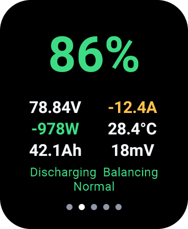
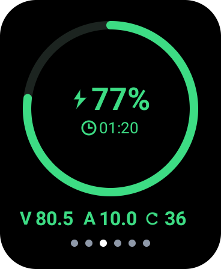
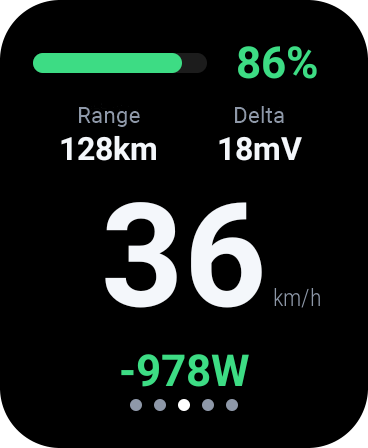
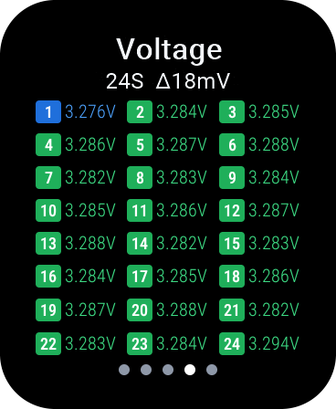
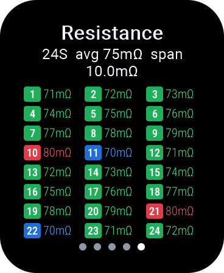
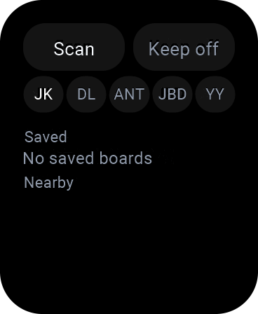

# BMS app for Android Wear OS

Read-only BMS app for the first-generation square Xiaomi Watch (2019, Wear OS 2.27). It reads a protection board over BLE and does not change protection settings.

The launcher name is **BMS** in both English and Chinese. The rest of the interface follows the watch language. Screenshots below are the English interface.

Package `com.luojuly.watchbms`. `minSdk 25`, `targetSdk 28`, `compileSdk 34`. The target stays at 28 so the app matches that watch.

## Device

Xiaomi Watch, model XMWT01, announced 5 November 2019. The system image is MIUI For Watch, which is Wear OS by Google (this app targets Wear OS 2.27). Specs below are from [OpenWearWiki](https://yizigezi.github.io/OpenWearWiki/xiaomiwatch.html#dvcvi3_4).

| Item | Value |
| --- | --- |
| Model | XMWT01 |
| Body | 44.69 × 36.92 mm, about 44 g |
| Colors | Tech silver, elegant black |
| Platform | Qualcomm Snapdragon Wear 3100 (Wear 3100 + QCC1110) |
| Display | 1.78 inch AMOLED, 368 × 448, 326 PPI, square |
| OS | MIUI For Watch (Wear OS by Google) |
| Memory | 1 GB LPDDR2 + 8 GB eMMC |
| Connectivity | LTE (eSIM), Bluetooth 4.2, Wi-Fi 802.11 b/g/n 2.4 GHz, NFC |
| Positioning | GPS, GLONASS, BeiDou |
| Sensors | PPG heart rate, stress, sleep |
| Battery | 570 mAh, about 36 hours |
| Materials | Gorilla Glass 3, aluminum case, stainless steel crown |
| Companion apps | Xiaomi Wear, Wear OS by Google |

## Screenshots

The speed page opens first. Swipe up through weather, battery, speed, voltage, and resistance, then back to weather. After the board has been charging for more than 10 seconds while GPS speed is 0 (or GPS speed cannot be read), a charging page is inserted between battery and speed. Disconnected pages use a fixed 24-cell demo.

| Weather | Battery | Charging | Speed |
| --- | --- | --- | --- |
|  |  |  |  |

| Voltage | Resistance | Settings | |
| --- | --- | --- | --- |
|  |  |  | |

## Pages

- **Weather.** GPS first, then the system network location. Without a fix it shows “Locating”. Coordinates are not stored, and the app does not look up the position from an IP address. Forecast and place name come from Open-Meteo.
- **Battery.** State of charge, power, temperature, capacity, and status.
- **Charging.** Shown after the board has been charging for more than 10 seconds while GPS speed is 0. If GPS speed cannot be read, the speed check is skipped. Regenerative braking while moving does not open this page. Ring, remaining time, voltage, current, cycle count, and clock.
- **Speed.** State of charge, range, voltage difference, speed, and power. Speed uses the watch GPS, then a network fix when GPS has no new position.
- **Voltage and resistance.** Three cells per row.
- **Settings.** Swipe left to open. Saved boards are listed above unsaved scan results. Up to 10 boards can be saved. The protocol row is JK, DL, ANT, JBD, and YY. A recognised board connects with the protocol in its name or services. An unknown board uses the lit protocol. A saved board keeps its own protocol; tap that label to switch it. JK still tries the password saved for that board, or `1234` when none is saved. If the board rejects it, the keypad opens, and the password entered there is saved on that board. DL, ANT, JBD, and YY do not use that password. They also have no cell resistance, so the resistance page shows —.

Up, down, and left swipes slide the page in the direction of the finger. On settings, only a left swipe returns to the previous page. Up and down do not leave settings. A right swipe is left to the system and dismisses the app. The crown scrolls lists. A finger drag does not. Page dots appear on a data page and hide after 5 seconds without a swipe.

Leaving the app drops the BLE link. Range uses that board’s last 200 km of energy use. Until 200 km is recorded, range shows “—”. Deleting a board deletes its record.

## Protocols

The app is read-only and keeps one connection. Positive current means charging on every protocol. A scan uses the advertised name first, then the advertised services. A saved board keeps the protocol stored with it.

| Protocol | How a scan recognises it | Read path |
| --- | --- | --- |
| JK | Name starts with `jk` | JK02 on service `FFE0`, characteristic `FFE1`. Device info `0x97`, then cell info `0x96`. Password is the one saved for that board, or `1234`. |
| DL | Name starts with `DL-BMS`, or the advertisement has both `FFE0` and `FFE2` | `FFE1` write, `FFE2` notify. Key exchange, then one encrypted status read. |
| ANT | Name starts with `ANT` or contains `ant@` | `7E A1` status request on `FFE0` / `FFE1`. |
| JBD | Name contains `jbd` or `xiaoxiang`, or the advertisement has service `FF00` | Service `FF00`. Basic pack on `0x03`, cell voltages on `0x04`. |
| YY | Name contains `yanyang`, `yybms`, `yy-bms`, `hlk-b40`, or `b40`, or the advertisement has the Nordic UART service | One Modbus holding-register read, on `FFE0`, `FF00`, or the Nordic UART service. |

DL, ANT, JBD, and YY do not use the JK password. Their frames have no cell resistance, so the resistance page shows —. A board the scan cannot recognise uses the lit protocol on the settings row.

## Build

JDK 17 is required. Dependencies use the domestic Maven mirrors configured in the project.

```powershell
$env:JAVA_HOME = "D:\Android\jdk-17"
.\gradlew.bat testDebugUnitTest assembleRelease
```

The release package is signed with the debug certificate. This package does not replace an older install of `com.luojuly.watchjkbms`; uninstall that package first if both should not stay on the watch:

```powershell
adb install -r app\build\outputs\apk\release\app-release.apk
```
